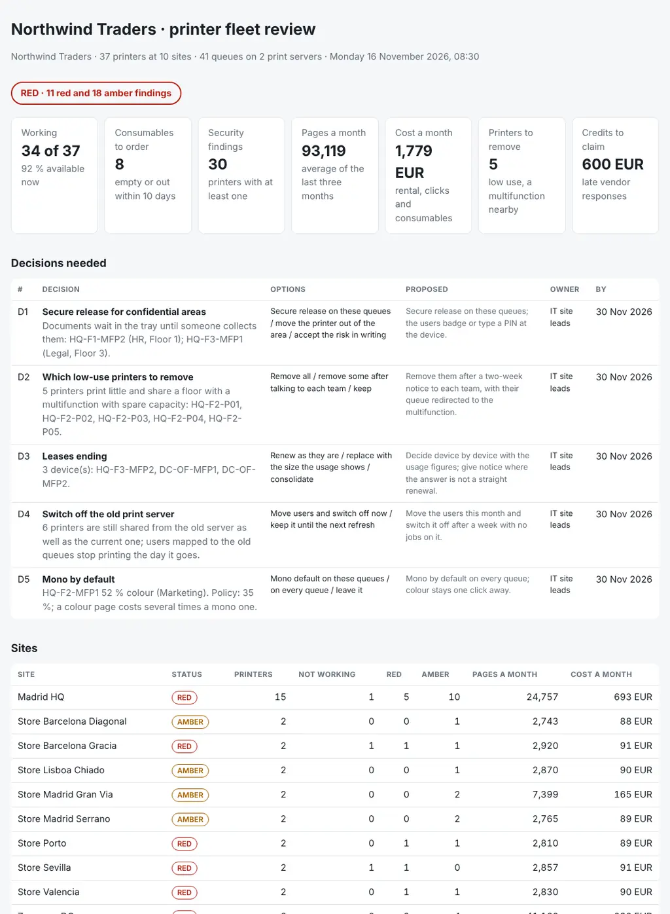

# Printer Fleet Health

The question for the service desk and the site leads every month: is every printer printing, will it keep printing, is it safe, and is it the right fleet? From the printer register, the print server queues, what the devices report about themselves (managed print portal or SNMP), the consumables, the page counters, the print contracts and the printer tickets, it puts together:

- **Fleet and queues:** printers down, stuck and paused queues, queues that print to an address the printer no longer has, the same printer shared from an old and a new print server, queues and devices nobody registered, and printers with no queue.
- **Consumables:** what is empty or will run out before the next delivery at the rate of the last 30 days, and the date to order it.
- **Usage and cost:** pages per device against what each type is built for (overworked devices, low-use printers next to a multifunction with room to spare), colour share, and the monthly cost per site and department from rental, clicks and consumables.
- **Security:** factory admin passwords, confidential areas without secure release, unencrypted management protocols, SNMP v1/v2c, firmware and drivers below the approved versions.
- **Lifecycle and service:** devices past their age, leases ending with the date to give notice, repeat tickets on one printer, and vendor break-fix calls answered later than the contract says, with the service credits due.

Every finding has an owner and a due date, the choices (secure release, which printers to remove, leases, the old print server, mono by default) become **decisions**, and `review-pack.md` is the page for the monthly review.

Python 3.10+, standard library only. It runs with fictional demo data out of the box. A read-only PowerShell script exports the queues from the Windows print servers.

It sits next to [42-retail-store-it-health](https://github.com/inigogonzalezgarcia/42-retail-store-it-health), which checks the stores as a whole, and [38-it-asset-lifecycle-planner](https://github.com/inigogonzalezgarcia/38-it-asset-lifecycle-planner), which plans the refresh of the rest of the hardware.



## Why

Printers are the most visible device in an office or a store and the least looked after. In a typical month:

- a store multifunction takes a new address from DHCP after a power cut, the queue keeps printing to the old one, and the store opens four "printer offline" tickets in three weeks that get closed by restarting the queue;
- the warehouse queue for delivery notes stops behind one job and nobody notices until the lorries are waiting;
- yellow toner runs out on a Friday because nobody looked at the level on Monday;
- HR prints payslips to a tray in the corridor;
- five desk printers bought years ago print forty pages a month each, next to a multifunction that is a quarter used;
- the old print server is still sharing six printers, so the day it is switched off half a floor cannot print;
- a lease renews by itself because the notice date went by;
- the vendor takes 26 hours to answer a call with an 8-hour response time, and nobody claims the credit.

Each console shows its own part. The review reads them together and turns the result into a short list of fixes and decisions. The rules are in `settings.json` and `printfleet/checks.py`.

## What it checks

| Area | Code | Finding | Severity |
|---|---|---|---|
| Fleet | PRN-DOWN | Device offline, in error or not seen for 24 hours; queue offline or in error | RED |
| Fleet | PRN-QUEUE-IP | The queue prints to an address that is not the printer's | RED |
| Fleet | PRN-QUEUE-STUCK | Oldest job waiting more than 30 minutes; more than 60 or 10 jobs | AMBER; RED |
| Fleet | PRN-PAUSED, PRN-NOQUEUE | Queue paused; printer with no queue | AMBER |
| Fleet | PRN-DUP-QUEUE, PRN-UNREGISTERED, PRN-UNKNOWN-DEVICE | Shared from more than one server; queue or device not in the register | AMBER |
| Consumables | SUP-EMPTY, SUP-SOON | Empty or out within 2 days and not ordered; out within 10 days | RED; AMBER |
| Usage | USE-UNDER, USE-OVER, USE-COLOUR | Below the low-use level for its type; above the recommended volume; colour share over the policy | AMBER |
| Security | SEC-DEFAULT-ADMIN, SEC-RELEASE | Factory admin password; sensitive area without secure release | RED |
| Security | SEC-PROTOCOLS, SEC-SNMP, SEC-FIRMWARE, SEC-DRIVER | Telnet, FTP or HTTP on; SNMP v1/v2c; firmware or driver below the approved version | AMBER |
| Lifecycle | LIFE-AGE, LIFE-LEASE | Older than 7 years; lease ending (RED if the notice date is within two weeks or the lease has ended) | AMBER; RED |
| Service | SVC-REPEAT | 3 or more tickets on one printer in 30 days; 5 or more | AMBER; RED |
| Service | SVC-VENDOR-SLA | Vendor response longer than the contract, with the credit | AMBER |

[docs/data-format.md](docs/data-format.md) has every rule, column and setting.

## Outputs

| File | What |
|---|---|
| `report.html` | Tiles (working, consumables to order, security, pages and cost, printers to remove, credits), the decisions, the sites, the printers that need attention today, consumables, usage outside the range, cost by department and every finding |
| `review-pack.md` | One page for the monthly review: result, headlines, sites, decisions, actions with owner and date, consumables to order, vendor, sources and notes |
| `printers.csv` | One row per printer: where, queues, state, firmware, pages, colour, cost, contract, lease, status and findings |
| `supplies-forecast.csv` | Every consumable with its level, use per day, days left, the date to order and whether it is on order |
| `queues-review.csv` | Every queue with its port address, driver, status, jobs and what is wrong with it |
| `usage-and-cost.csv`, `consolidation.csv` | Pages, colour, trend, load and cost per printer; the low-use printers and the multifunction to move their users to |
| `vendor-sla.csv` | Every break-fix call with the response time against the contract and the credit |
| `findings.csv`, `actions.csv` | Every finding with severity, items, owner and due date; the same as actions with a reference and a done column |

## Try it

```bash
git clone https://github.com/inigogonzalezgarcia/55-printer-fleet-health.git
cd 55-printer-fleet-health
python -m printfleet demo
```

Open `output/report.html` and `output/review-pack.md`.

### The demo data

The demo is a made-up home goods retailer, Northwind Traders, with a head office in Madrid on three floors, a distribution centre in Zaragoza and eight stores in Spain and Portugal: 37 printers (A3 and A4 multifunctions, desk printers and label printers), 41 queues on two print servers, two fictional vendors, three months of counters and six weeks of tickets. The review runs on Monday 16 November 2026.

Everything is fictional: models, firmware, addresses, prices and tickets. The problems are placed on purpose among printers that are fine:

- **Down:** the Barcelona store multifunction took a new address after a power cut while its queue still prints to the old one, with 6 jobs waiting and 4 "offline" tickets in three weeks; a desk printer jammed on floor 3 (its third jam ticket this month); the Sevilla counter printer not seen for three days.
- **Queues:** the warehouse delivery-note queue stuck behind 37 jobs, the oldest 140 minutes old; a paused store queue; the old print server still sharing 6 printers on an older driver; a plotter and a temporary marketing queue nobody registered; a consumer inkjet found on floor 2.
- **Consumables:** 3 empty and not ordered (yellow toner on floor 1, a warehouse ribbon, the Valencia store's black toner), 5 more out within 10 days.
- **Security:** the HR and Legal multifunctions without secure release; two devices with the factory admin password; Telnet and FTP on 11 older devices; SNMP v2c on 24; 6 below the approved firmware.
- **Fleet and cost:** five desk printers on floor 2 printing 40 to 120 pages a month next to two multifunctions a quarter used; the Gran Via store multifunction at 140 % of its recommended volume; marketing printing 52 % in colour; 9 printers past 7 years; three leases ending in January, one with the notice date this Saturday; four vendor calls answered in 9.5 to 26 hours against 8.

The result: **RED**; 34 of 37 printers working; 8 consumables to order; 11 red and 18 amber findings and 5 decisions: secure release for HR and Legal, removing the five floor 2 printers, the three leases, switching off the old print server, and mono by default.

## Use it with your own data

1. Export (read-only):
   ```powershell
   .\scripts\Export-PrintQueues.ps1 -PrintServers PRT-SRV01, PRT-SRV02 -OutputFolder .\data
   ```
   It reads every queue with `Get-Printer`, `Get-PrinterPort`, `Get-PrinterDriver` and `Get-PrintJob`, and changes nothing.
2. Add the rest:
   - `printers.csv` from your printer register or CMDB (site, location, type, serial, address, department, contract, dates, secure release, sensitive area);
   - `devices.csv`, `supplies.csv` and `counters.csv` from your managed print portal's device, consumables and meter reports, or an SNMP scan;
   - `contracts.csv` and `tickets.csv` from the contracts and the ITSM tool, and `data/settings.json`: approved firmware and drivers, volumes, thresholds and owners ([docs/data-format.md](docs/data-format.md) has every column and setting).
3. Build the outputs:
   ```bash
   python -m printfleet review data/
   ```

[docs/review-runbook.md](docs/review-runbook.md) has the monthly cycle, how to read the result (printing today, then printing tomorrow, then safety, then the shape of the fleet), how to change queue ports, remove printers, update firmware and drivers and switch off a print server without surprises, and what to keep as evidence.

The exports contain internal addresses, device names, user-facing locations and ticket text. Keep them inside your organisation:

- real files at the top level (`printers*.csv`, `queues*.csv`, `devices*.csv`, `supplies*.csv`, `counters*.csv`, `contracts*.csv`, `tickets*.csv`, `settings.json`, `data/`) and the `output/` folder are excluded from Git by `.gitignore`;
- only the fictional files in `sample_data/` are committed.

## Tests

```bash
pip install -r requirements-dev.txt
python -m pytest -q
```

GitHub Actions runs them on Python 3.10 and 3.12 on every push, checks that the committed sample data is what the simulator writes, and keeps the demo report and a screenshot as build artifacts.

14 tests: the parsers (prices, types, versions, queue and device states); a clean fleet with no findings and its cost; a queue on an old address behind repeat tickets; down, stuck and paused queues; unregistered, duplicate and unknown devices; the consumables forecast and order dates; low use, overwork and colour with the consolidation target; security; lease notice dates; vendor response and credits; other column names and semicolons; a missing register; the demo end to end; and a deterministic demo.

## Next steps

- Run it on the first working day of every month and keep `printers.csv` to show the trend of pages and cost per site.
- Read the device data straight from the managed print portal's API or an SNMP poll instead of CSV exports.
- Send the consumables orders to the vendor portal from `supplies-forecast.csv`.
- Open the RED actions as tickets in the ITSM tool with the owner and due date.

## Background

Built from my work supporting offices and stores:

- printers in retail stores, and store openings;
- running the IT of an office site and supporting users across several offices;
- managing hardware vendors, service contracts and their SLAs;
- PowerShell automation, monitoring, and process ownership for incident and problem.

Written from scratch with fictional data; no employer data, systems or exports are used.

## Customisation and contact

Want this adapted to your environment? For example:

- your volumes, thresholds, approved firmware and drivers;
- your sources: another print portal, Universal Print or CUPS, your CMDB;
- your sites, departments and cost model;
- the pack in the format of your monthly review.

Get in touch:

- Website (contact form): [inigogonzalezgarcia.github.io](https://inigogonzalezgarcia.github.io/about.html#contacto)
- LinkedIn: [linkedin.com/in/igonzalez93](https://www.linkedin.com/in/igonzalez93)

## License

MIT
